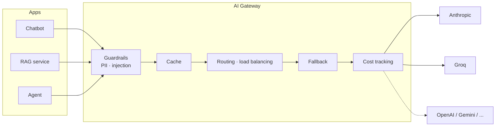

# AI Gateway Patterns with LiteLLM

A hands-on implementation of the core capabilities of an **AI (LLM) gateway** —
the infrastructure layer that sits between applications and LLM providers —
using [LiteLLM](https://github.com/BerriAI/litellm) on two real providers:
**Anthropic (Claude)** and **Groq**.

Each capability is a small, self-contained, runnable demo. The guardrails are
covered by offline unit tests, and the whole run reports its total spend.

```
uv run run_all.py
...
RUN SUMMARY
22 successful LLM calls, total cost $0.0xxx
```

---

## Why an AI gateway?

Without a gateway, every service talks to every provider directly:

- a provider outage or a retired model takes the application down;
- switching or A/B-testing providers means rewriting integration code;
- nobody can tell which feature generates the bill;
- PII and prompt-injection checks are duplicated (or forgotten) per service;
- identical questions are paid for again and again.

A gateway centralises these cross-cutting concerns in one place —
classic *separation of concerns*: business logic (chatbot, RAG, agents)
never mixes with infrastructure logic (routing, cost, security).



## What is demonstrated

| # | Capability | File | Key idea |
|---|---|---|---|
| 1 | **Unified API** | `demo_unified_api.py` | One `completion()` call and one response shape for every provider. |
| 2 | **Automatic fallback** | `demo_fallback.py` | Simulated outage on the primary; the backup answers transparently. |
| 3 | **Response caching** | `demo_caching.py` | The 2nd identical request is served from cache: ~1000× faster, $0. |
| 4 | **Cost tracking** | `demo_cost_tracking.py` | Exact USD per call, tagged with `user=` for chargeback. |
| 5a | **Smart routing** | `demo_routing.py` | A cheap classifier sends each task to the right model tier. |
| 5b | **Load balancing** | `demo_routing.py` | `Router` spreads one alias (`chat-pool`) across equivalent deployments. |
| 6 | **Guardrails** | `demo_guardrails.py`, `guardrails.py` | PII is *redacted and forwarded*; prompt injection is *blocked*. |
| 7 | **Framework integration** | `demo_langchain.py` | `ChatLiteLLM` in an LCEL chain + LangChain-level `.with_fallbacks()`. |

Routing policy used in 5a:

| Task class | Model | Why |
|---|---|---|
| `code` | Claude Sonnet 4.6 | complex reasoning -> strongest model |
| `summary` | Claude Haiku 4.5 | simple transformation -> cheaper tier |
| `general` | GPT-OSS 120B on Groq | trivia / chit-chat -> fastest and cheapest |

## Quick start

Requirements: Python 3.11+, [uv](https://docs.astral.sh/uv/).

```bash
cp .env.example .env        # add ANTHROPIC_API_KEY and GROQ_API_KEY (Groq has a free tier)
uv sync
uv run run_all.py           # all demos + total spend
uv run demo_guardrails.py   # or any single demo
uv run pytest               # offline guardrail tests — no API keys needed
```

A full run makes ~22 LLM calls and costs a few cents (all spend is on Anthropic;
Groq's free tier covers the rest). The exact figure is printed at the end.

## Project structure

```
├── common.py              # logging setup, model registry, spend tracking, console helpers
├── guardrails.py          # PII redaction, injection blocking, guarded_completion()
├── demo_*.py              # one capability per file, each runnable on its own
├── run_all.py             # runs every demo, prints total spend
├── tests/test_guardrails.py
├── .env.example
└── pyproject.toml / uv.lock
```

## Engineering notes

Problems found while building and testing this project — and how they were solved.

**1. `litellm.input_callback` cannot enforce guardrails.**
The obvious way to add guardrails in the LiteLLM SDK is to register them as
`input_callback`s. It doesn't work: the hook is a *logging* hook. Any exception
raised inside it is caught and swallowed (so a "blocking" guardrail lets the
request through — verified empirically), and mutating the messages there does
not change what is sent. Guardrails therefore run explicitly in
`guarded_completion()`, and a test asserts that a blocked request never reaches
the provider. Real blocking pre-call hooks exist in the LiteLLM **Proxy**
(`async_pre_call_hook`).

**2. Overlapping PII formats leak data.**
An unanchored 9-digit phone regex matched the first 9 digits of an 11-digit
national ID, redacting it to `[PHONE]59` — two digits exposed. Fix: numeric
patterns are anchored with `(?<!\d)…(?!\d)` and applied longest-first
(card -> national ID -> phone). Card candidates must also pass a **Luhn checksum**
to avoid redacting arbitrary digit runs. Both cases have regression tests.

**3. Reasoning models consume `max_tokens` before answering.**
`gpt-oss-120b` spends hidden reasoning tokens from the same budget. A classifier
with `max_tokens=5` returned `content=None`. Fix: a larger budget plus
`reasoning_effort="low"`, and defensive handling of empty content.

**4. LLM output is not an enum.**
The classifier answers `"Code."`, `"'summary'"`, `"This is code"`. Exact
dictionary lookup silently routed *everything* to the default model. Labels are
now matched as substrings with an explicit default.

**5. Providers retire models.**
`groq/llama-3.3-70b-versatile` was shut down by Groq in August 2026 and started
returning `model_not_found`. All model IDs now live in one registry
(`common.py`), so a deprecation is a one-line change — which is itself one of the
arguments for having a gateway.

**6. "Handled" errors still print scary tracebacks.**
LiteLLM logs recovered fallback failures with `logger.exception()` — at ERROR
level — so the common `setLevel(logging.ERROR)` advice doesn't silence them.
`CRITICAL` does; real failures still surface as exceptions.

**7. Dependency pinning matters.**
In `litellm 1.108.x` a cache *hit* in the SDK imports proxy-only modules and
crashes without `fastapi`. The project pins the verified `1.93.x` line;
`uv.lock` makes the environment reproducible.

## Scope and limitations

This project uses LiteLLM as an **in-process library**, which keeps every
mechanism visible in a few lines of code. In production, a gateway is usually a
**separate service** that all applications call over HTTP — that is what makes
centralised keys, budgets and policies possible across teams.

Other deliberate simplifications:

- in-memory cache (per process, lost on restart);
- regex/heuristic guardrails — easy to bypass by paraphrasing;
- input guardrails only (no output moderation);
- no rate limiting or budgets.


## Tech stack

Python 3.11+ · LiteLLM · LangChain (`langchain-litellm`) · Anthropic Claude
(Sonnet 4.6, Haiku 4.5) · Groq (GPT-OSS 120B) · pytest · uv
